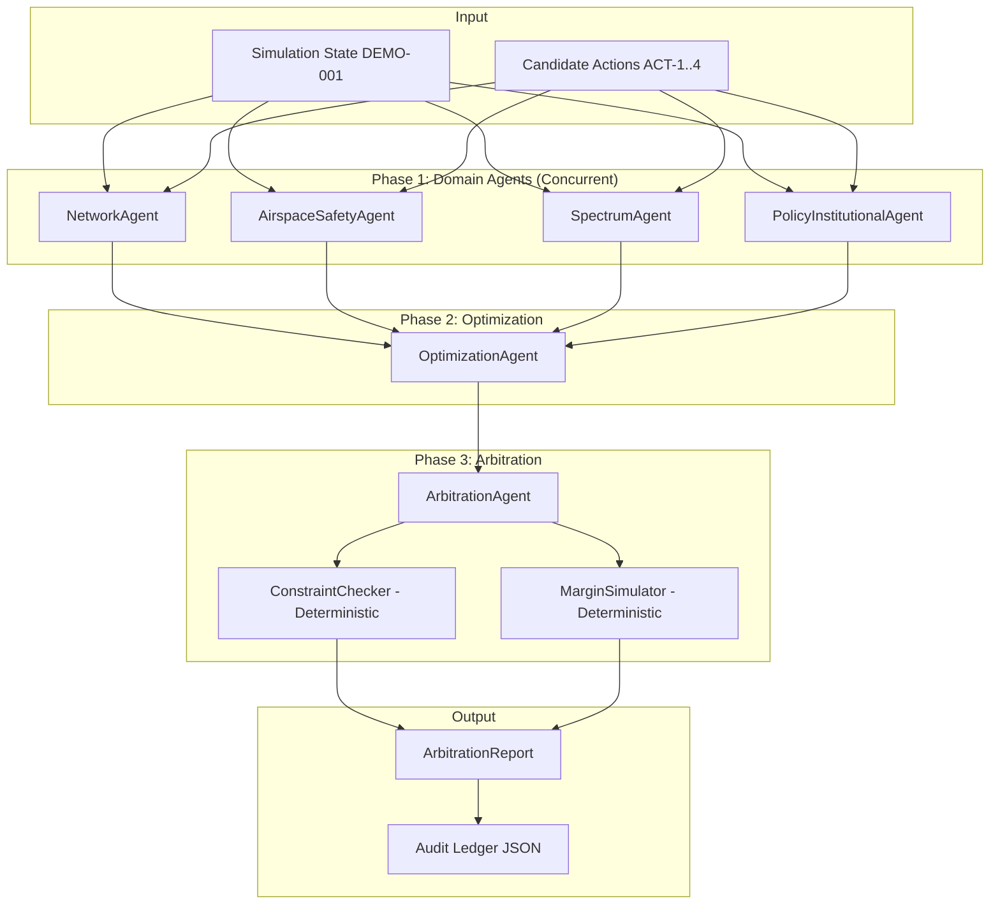

# SkySync: Architectural Design Document

## 1. System Vision & Safety Philosophy
SkySync is an autonomous safety arbitration engine designed to resolve spectrum interference conflicts between terrestrial 5G base stations (operating in the C-band / n78 / n77) and civil aviation radar altimeters (operating in the protected aeronautical radionavigation band 4200–4400 MHz).

The foundational principle of SkySync is:
> **"Deterministic code decides, LLMs reason."**
> Hard safety constraints and physical propagation laws are enforced deterministically in Python. Large Language Models provide domain synthesis, qualitative contextualization, and rationale, but can never override hard constraint failures or invent safety margins.

---

## 2. Multi-Agent Architecture

### Agent Responsibilities
1. **NetworkAgent**: Analyzes cellular performance metrics (PRB utilization, throughput drop percentage, user QoS). Suggests candidate mitigation actions such as power adjustments or load balancing.
2. **AirspaceSafetyAgent**: Models the 3D approach corridor, glideslope elevation, and distance to threshold. Runs `MarginSimulator` to predict PFD levels against ITM tolerance curves with mandatory 6 dB margin (CLM-106).
3. **SpectrumAgent**: Enforces ITU-R Radio Regulations (RR 5.438) protecting 4200–4400 MHz exclusivity, verifies national frequency licensing boundaries (e.g. 3300–3670 MHz in India), and verifies out-of-band spurious limits (-46 dBm/MHz conducted, -28.4 dBm/MHz EIRP).
4. **PolicyInstitutionalAgent**: Inspects circulars and orders, evaluating temporal status against scenario `as_of` dates (Rule 3: future effective dates become `NOT_YET_IN_FORCE`), checks human authorization constraints (CON-IN-004), and flags unquantified policy gaps (GAP-006).
5. **OptimizationAgent**: Models multi-objective Pareto trade-offs. Ranks non-intrusive off-corridor traffic steering (>1200 m separation) and antenna downtilts as superior to power escalation.
6. **ArbitrationAgent**: Evaluates all candidate actions against the deterministic `ConstraintChecker`. Actions failing hard constraints are rejected. Synthesizes cross-agent assessments and outputs the accepted action, rejection rationale, and safety status.

---

## 3. RAG Pipeline & Retrieval Strategy

- **Hybrid Retrieval**: Combines BM25 lexical ranking and dense vector representations via `sentence-transformers` (`BAAI/bge-small-en-v1.5`).
- **Reciprocal Rank Fusion (RRF)**: Merges sparse and dense ranked candidate lists ($k=60$).
- **Metadata-Aware Scoring**:
  - `fetched_full_text_primary`: 1.15x boost
  - `search_snippet_primary`: 1.0x baseline
  - `secondary_report` (Tier-3): 0.6x down-weight
  - `legacy`: 0.5x down-weight
  - `superseded`: 0.3x down-weight
- **Domain Query Planning & Jurisdiction Filtering**: Pre-filters documents matching the target jurisdiction (or international) and the agent's functional role.

---

## 4. Deterministic Tools & Verification Guards

### Margin Simulator
Implements the exact Power Flux Density (PFD) geometric spreading model:
$$\text{PFD}_{\text{dBW/m}^2\text{/MHz}} = (\text{EIRP}_{\text{per\_pol}} - 30) - 10 \log_{10}(4 \pi d^2)$$
$$\text{Margin} = \text{Threshold} - (\text{PFD} + \text{Aggregation} + \text{Required Margin})$$
Reproduces FAA CLM-109 compatibility benchmark values to within $\pm 0.1$ dB. All outputs are explicitly tagged with `SIMULATION`.

### Evidence Guard
- **Rule 2 (Anti-Hallucination)**: Any claim cited by the LLM that is not in the knowledge base is stripped, and a warning is logged.
- **Rule 4 (Tier-3 Evidence)**: Secondary reports generate advisory warnings rather than hard rejections.
- **Rule 6 (Conflict Retention)**: Divergent positions (e.g. `CONF-001`) are cited explicitly rather than averaged.
- **Rule 7 (Precautionary Fallback)**: If an agent computation times out or errors, the system generates a conservative precautionary report rather than terminating.

---

## 5. Auditability & Observability
Every execution run generates a complete audit trail persisted to `runs/{run_id}.json`. The audit ledger captures the raw input state, candidate actions, retrieved evidence IDs, agent observations, deterministic constraint pass/fail/unknown evaluations, final arbitration verdict, and execution latency.
